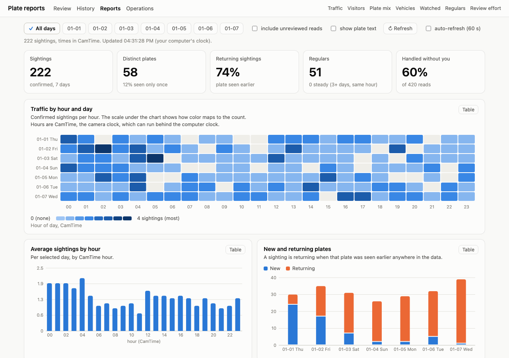
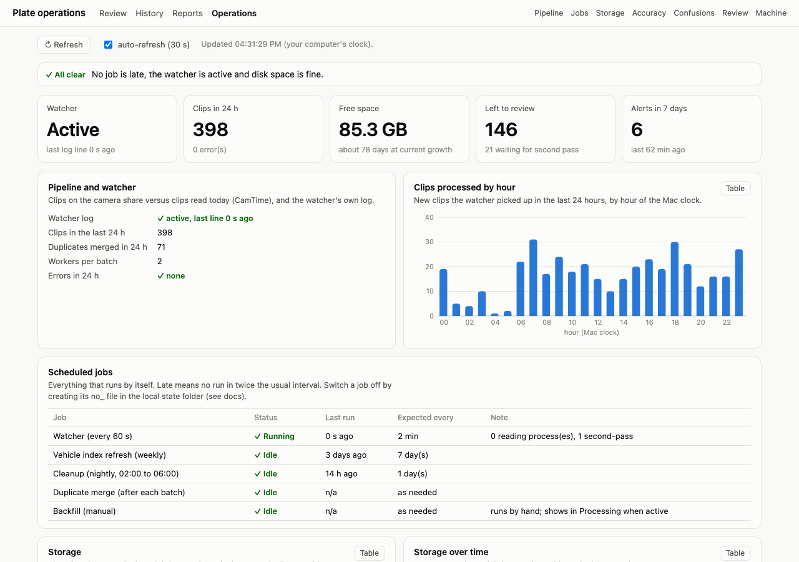
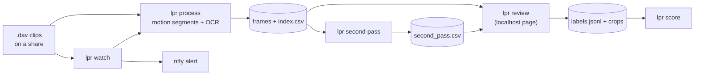

# lpr-dav-ocr

Local license plate reading for a fixed camera that records `.dav` clips, with a human review page,
accuracy scoring, and watchlist alerts.

Everything runs on your own machine. Recordings, frames, labels and results never leave it. The only
network use is a one-time download of the OCR models and, if you turn it on, push alerts through
[ntfy](https://ntfy.sh).


*Every plate in this repository's screenshots, tests and demo data is made up.*

| Reports | Operations |
|---|---|
| [](docs/reports.md) | [](docs/operations.md) |

*Both pages run on made-up data from `lpr demo results --days 7`.*

## What it does

- **Reads plates from clips.** It finds the moments of motion in each clip, reads only those frames,
  and keeps the best frame per plate. It does not read every frame.
- **Checks itself.** A second, independently configured pass re-reads each saved frame. When the two
  passes agree, the read is right about 95% of the time. When they disagree, you are asked.
- **Lets you review fast.** A local web page shows the frame, a leveled crop of the plate, and one box
  per character, so fixing a misread means changing one box. Verdicts: correct, fix, not a plate,
  obstructed, can't tell. Confident, agreeing reads can skip the queue. Clickable hints, the plate's history and its NYC ticket
  record update as you type, in a couple of milliseconds. See [a review session](docs/review-ui.md#a-review-session-step-by-step).
- **Measures accuracy from your labels.** `lpr score` reports exact-match accuracy, how trustworthy the
  confidence is, and a character confusion table (for example M read as H).
- **Cuts the review work.** Duplicate sightings of one plate are merged, reads equal to a plate you verified recently
  are approved, and reads of badges and signs are rejected, all with the clearer frame kept and your labels always winning.
- **Knows the vehicle.** A local index built from public NYC parking-ticket data gives make, body type, year and color for
  many plates, with no plate sent to anyone. See [ADR 0016](docs/adr/0016-local-vehicle-index-from-ticket-data.md).
- **Reports and operations pages.** Traffic, repeat visitors, plate mix and fleet mix on `/reports`; watcher health, jobs,
  disk use, accuracy and a confusion matrix on `/ops`.
- **Looks after itself.** A nightly cleanup stores frames losslessly in a third of the space and trims caches.
- **Watches for plates you care about.** A background watcher processes new clips as they appear and
  sends an ntfy alert for exact and one-character-off matches against a watchlist.

## How the pieces fit



See [docs/architecture.md](docs/architecture.md) for the details and the
[decision records](docs/adr/) for why it is built this way.

## Quick start

Requirements: Python 3.11 or 3.12 (PaddlePaddle has no wheels for newer versions yet), about 4 GB of
disk, and about 1 GB of RAM per worker. macOS is the tested platform. Full steps are in
[docs/installation.md](docs/installation.md).

```bash
git clone <this repository> && cd lpr-dav-ocr
python3.12 -m venv .venv && source .venv/bin/activate
pip install -e ".[ocr]"
lpr setup                      # downloads the OCR models (once)
```

Try it without a camera or any real plate:

```bash
lpr demo results --out /tmp/lpr-demo     # fake processed results
lpr review --root /tmp/lpr-demo          # open http://localhost:8770/
```

Run it on your own clips:

```bash
lpr config init                          # then set paths.camera_dir in the file it names
lpr process /path/to/camera/2026-01-01   # reads one day of clips (resumable)
lpr second-pass "$(lpr where /path/to/camera/2026-01-01)"
lpr review                               # label what it found
lpr score                                # how accurate was it?
```

## Commands

| Command | What it does |
|---|---|
| `lpr process <day-folder>` | Find plates in a folder of clips. Resumable. |
| `lpr second-pass <frames-folder>` | Re-read saved frames un-rotated for a second opinion. |
| `lpr review` | Local review page (binds 127.0.0.1 only). |
| `lpr score` | Accuracy against your labels, plus a confusion table. |
| `lpr dedupe` | Merge duplicate sightings of one plate (keeps the clearer frame). |
| `lpr vehicles import\|refresh\|lookup` | Local make, body, year and color by plate from NYC ticket data. |
| `lpr cleanup` | Free disk space safely: gray frames, image cache, merged-away frames, logs. |
| `lpr seen <plate>` | Every time one plate was seen (exact match). |
| `lpr ops` | Operations data as JSON, or `lpr ops snapshot` for the daily storage sizes. |
| `lpr watch` | Process new clips as they appear and alert on watchlist plates. |
| `lpr watchlist add\|remove\|list` | Manage watched plates. |
| `lpr demo results\|clips` | Synthetic data to try everything without a camera. |
| `lpr setup`, `lpr config`, `lpr where` | Models, configuration, output folder lookup. |

## Configuration

One TOML file, with a documented template in [config/config.example.toml](config/config.example.toml).
Nothing in the code names a camera, a host or a path. See [docs/configuration.md](docs/configuration.md),
including how to measure your camera's plate tilt.

## Privacy

License plates are personal data. This project is built to keep them on your machine:

- processing and review are local, and the review server listens on `127.0.0.1` only
- the repository ignores recordings, frames, indexes, labels, the watchlist and the notification topic
- `scripts/check-private-data.sh` blocks a commit or CI run that contains any of them
- all documentation images, tests and demo data are synthetic

Read [docs/privacy.md](docs/privacy.md) before running this on footage of other people, and before
turning on alerts: an alert that includes a plate leaves your machine.

## Status

A personal project, developed against one camera model and one site. It works well there and has
sharp edges elsewhere. [docs/known-issues.md](docs/known-issues.md) lists them honestly,
[docs/accuracy.md](docs/accuracy.md) says how accuracy was measured and what the numbers do not mean.

## Documentation

- [Installation](docs/installation.md) and [configuration](docs/configuration.md)
- [Usage](docs/usage.md) and [the review page](docs/review-ui.md)
- [Vehicle lookup by plate](docs/usage.md#vehicle-make-body-year-and-color) from public NYC ticket data, kept local
- [Reports](docs/reports.md): traffic, repeat visitors, plate mix, vehicles and review effort
- [Operations](docs/operations.md): watcher health, scheduled jobs, disk use, accuracy and the confusion matrix
- [Watcher and alerts](docs/watcher-and-alerts.md)
- [Architecture](docs/architecture.md) and [decision records](docs/adr/)
- [Accuracy](docs/accuracy.md), [privacy](docs/privacy.md), [known issues](docs/known-issues.md)
- [Contributing](CONTRIBUTING.md) and the [changelog](CHANGELOG.md)

## License

MIT. See [LICENSE](LICENSE).
