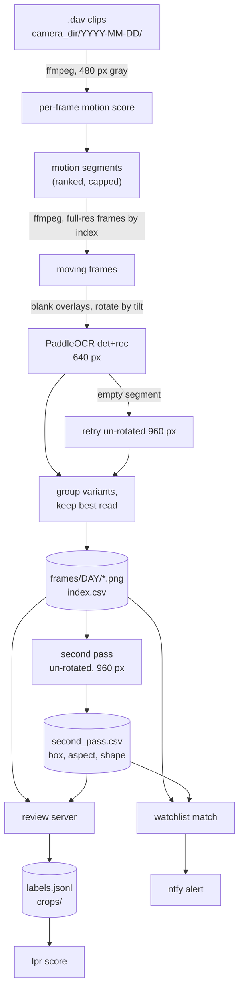

# Architecture

## Goals and constraints

- Read plates from a **fixed camera's** motion-triggered `.dav` clips, locally, on a laptop CPU.
- Make the human the final judge and make their work cheap, then learn from it.
- Be honest about uncertainty: two independent reads, confidence, agreement and shape are all surfaced.
- Keep personal data on the machine. See [ADR 0001](adr/0001-local-first-processing.md).

## Components

| Module | Command | Role |
|---|---|---|
| `pipeline` | `lpr process` | Motion segmentation, frame selection, OCR, best-frame export. |
| `second_pass` | `lpr second-pass` | Independent re-read of saved frames, plate location, shape. |
| `review.server`, `review/page.html` | `lpr review` | Local review page and its JSON API. |
| `score` | `lpr score` | Accuracy against labels, confidence calibration, confusion table. |
| `watch`, `watchlist` | `lpr watch`, `lpr watchlist` | Unattended processing of new clips, watchlist matching, ntfy alerts. |
| `config` | `lpr config` | Defaults, TOML file, environment. |
| `demo` | `lpr demo` | Synthetic data. |
| `cli` | `lpr` | Dispatcher. |

## Data flow

## The pipeline in detail

1. **Probe and motion pass.** The clip is decoded once at 480 px wide, gray. The mean absolute change from the
   previous frame, outside the overlay boxes, is the motion score. Decoding is cheap next to OCR.
2. **Segments.** Frames whose score exceeds `max(min_motion, median + k * MAD)` are grouped into bursts
   (a gap of more than 15 frames starts a new one). Each burst is roughly one vehicle pass. Bursts are ranked by
   total motion above the threshold and only the strongest `max_segments` are kept. Plates appear within about a
   second of motion onset, and onset moves around inside the clip, so the clip's centre is not a good guess
   ([ADR 0002](adr/0002-motion-segments-and-onset-anchored-frames.md)).
3. **Frame selection.** Every `stride`th frame of a burst (with a pad) up to `max_frames`, read back by frame index
   (seeking by time is unreliable on these files).
4. **Read.** Overlays are blanked, the frame is rotated by `tilt_degrees`, and PaddleOCR detects and recognises
   text at `det_side`. A read must match `plate_regex` and `min_conf`.
5. **Early stop.** A burst stops once `stop_hits` reads reach `stop_conf` and at least `min_frames` frames were read.
6. **Fallback.** If rotation found nothing in one of the top bursts, a few of its frames are read un-rotated at 960 px.
7. **Group and save.** Reads that contain each other or differ by one character are one plate. The best read
   (highest confidence, with a small preference for the longer read) names the saved full frame:
   `<date>_<start>-<end>-<PLATE>_<conf>.png`. A row per plate goes to `index.csv`.

Clips run in a `spawn` process pool. Each worker loads the models once. The process ends with `os._exit` because
PaddlePaddle's thread pool crashes during a normal interpreter shutdown ([KI-3](known-issues.md#ki-3)).

## Second pass

Re-reads each saved frame without rotation at 960 px, picks the read that best matches the first-pass plate
(or the most confident one), and records its confidence, its box, and the **aspect ratio** of the detected text
region. US plates are 2:1, and plate text regions cluster near that, while model names and signs do not
([ADR 0006](adr/0006-plate-shape-hint-not-a-character-filter.md)). Only one second pass runs per folder at a time
(a lock file in `<home>/locks`).

## Files and schemas

All are plain text. No database.

**`frames/<date>/index.csv`** (one row per plate, plus one per clip with no plate):

`clip, plate, conf, frame, variants, image, frames, segments, ocr_frames, secs`

`variants` is `|`-separated other reads grouped with this plate. `frame` is the frame index of the saved frame.

**`frames/<date>/second_pass.csv`**:

`image, plate1, conf1, plate2, conf2, agree, x0, y0, x1, y1, aspect, shape, secs`

`shape` is `ok` (aspect 1.5 to 3.0), `wide` or `narrow`. Empty `plate2` and box mean the second pass ran and
found nothing.

**`labels/labels.jsonl`**: see [review-ui.md](review-ui.md#where-your-labels-go).

**`<home>/watchlist.csv`**: `plate, nickname, added`. **`<home>/alerts.jsonl`**: what was sent, for de-duplication.

## The review server

A `ThreadingHTTPServer` bound to `127.0.0.1`. Reads of the CSV and label files use a short-lived cache with
background refresh, because file modification times on network shares are not reliable and reads can be slow.
The JSON API: `GET /api/item`, `GET /api/config`, `GET /api/watch`, `POST /api/label`, `POST /api/watch`,
`POST /api/watch/remove`, `GET /img/<name>`. Pages are `/` (redirects to the first plate that needs review)
and `/i/<image>`.

## The watcher

A polling loop (see [watcher-and-alerts.md](watcher-and-alerts.md)). It shells out to `python -I -m lpr_dav_ocr...`
for the pipeline and second pass so that each batch gets a clean process and a clean exit.

## Why no database

Everything is append-only text that a person can read, diff, back up and delete. SQLite does not behave on
network shares. If a query layer is needed later, build it from these files
([ADR 0009](adr/0009-data-layout-and-share-caching.md)).
