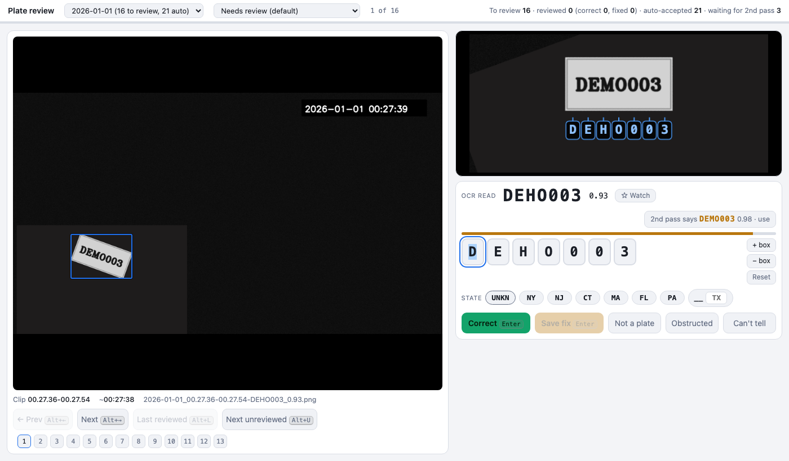

# The review page

`lpr review` starts a small web server on `127.0.0.1` (default port 8770). Nothing is sent anywhere. The
page is for labelling what the pipeline found, which gives you accuracy numbers and training data.

## What is on the page

- **Left:** the saved frame with the plate outlined, the clip and approximate time, and navigation: Previous,
  Next, **Last reviewed** (the furthest plate you have reached in time order) and **Next unreviewed**.
- **Top right:** a leveled crop of the plate. The letters of the current text are drawn under it, one per plate
  position, so you can compare read against plate. Letters you changed turn amber.
- **OCR read:** the read and its confidence, a plate-shape warning when the text region is not plate-shaped,
  an *auto-accepted* badge when the rule applies, and **2nd pass says X**: the second read. Click it to copy
  that read into the boxes.
- **Character boxes:** one input per character. Typing replaces the character and moves on. Arrow keys move
  between boxes. `+ box` and `- box` insert and delete a box. A changed box shows what it was ("was H"), an
  inserted one shows "new". The comparison is an alignment, so adding a character at the front does not mark
  every later box.
- **State:** `UNKN` (default), common states, and a free-text two-letter box. It is stored with the verdict.
  Nothing resolves it automatically.
- **Buttons:** see below.
- **Watch:** adds the plate (the corrected text if you edited the boxes) to the watchlist. See
  [watcher-and-alerts.md](watcher-and-alerts.md).

## Verdicts

| Button | Meaning | Training use |
|---|---|---|
| **Correct** (Enter) | The read is right. Enabled only while the boxes are unchanged. | positive example |
| **Save fix** (Enter) | You changed at least one box. The boxes are the truth. | corrected example |
| **Not a plate** (Alt+N) | There is no plate in the outlined area (a sign, a model name, a dealer frame). | false-positive example |
| **Obstructed** (Alt+O) | A plate is there but cannot be read (blocked, glare, blur, cut off). | excluded from accuracy, useful for quality filtering |
| **Can't tell** (Alt+S) | You are unsure what it is. | excluded |

Enter does the right thing for the state of the boxes: no change means Correct, a change means Save fix.
After each verdict the page moves to the next plate that needs review.

## Which plates are queued

The header menu chooses the view. Counts are per day. A **day** menu lists every processed day.

| View | Shows |
|---|---|
| **Needs review** (default) | Plates with a second pass, no verdict yet, and not auto-accepted. |
| **Auto-accepted: spot check** | Plates that met the auto-accept rule. Look at some to audit it. |
| **All unreviewed** | The first view plus the auto-accepted ones. |
| **Everything** | Every plate, including ones still waiting for a second pass. |

A plate enters a review queue only after the second pass has run on it, even when that pass found no read.
Plates still waiting are counted in the header ("waiting for 2nd pass") and join the queue on their own.

**Auto-accept rule:** confidence at or above `review.auto_accept_conf` (0.99), both passes agree, and the
text region has a plate-like shape. Auto-accepted plates get **no** human label, so treat them as weak labels.
Validate the rule on your own data before trusting it: `lpr score` prints its precision.

## Keyboard

| Key | Action |
|---|---|
| Enter | Correct, or Save fix when a box was changed |
| Alt+N / Alt+O / Alt+S | Not a plate / Obstructed / Can't tell |
| Alt+Left, Alt+Right | Previous, next |
| Alt+L, Alt+U | Last reviewed, next unreviewed |
| Left, Right, Backspace | Move between character boxes |

Plain letters are not shortcuts because they would clash with typing into the boxes.

## Where your labels go

`<data_root>/labels/labels.jsonl`, one JSON object per line, appended and flushed immediately. The latest line
for an image wins, so you can revisit and relabel. Fields:

| Field | Meaning |
|---|---|
| `ts` | when you saved it (ISO 8601 with offset) |
| `image`, `clip`, `day` | which plate |
| `plate_ocr`, `conf` | the first-pass read and its confidence |
| `plate_second`, `shape` | the second-pass read, the shape class at that time |
| `verdict` | `ok`, `fix`, `notplate`, `obstructed` or `skip` |
| `truth` | the true plate for `ok` and `fix`, else null |
| `state` | `UNKN` or a state code |

For `ok` and `fix`, a leveled crop is saved to `<data_root>/crops/<image name>__<truth>.png`.

Labels are keyed by the image file name. Do not rename saved frames.

## NYC TLC pattern hint

Taxi and for-hire plates in New York City are a T or Y, six digits and a letter (for example `T123456C`). On the
author's labels the reader got 24 of 71 such plates wrong, almost always reading the T as `1` or the final C as `0`.
When a read can be made to fit the pattern, the page offers **NYC TLC pattern T123456C - use** and one click copies it
into the boxes. If the read already fits, a small "fits the NYC TLC pattern" badge appears instead.

It is a hint only. It never filters plates, never changes a stored read and never feeds auto-accept. On the author's
labels the rule would have fixed 16 of the 24 wrong TLC reads and made 3 wrong suggestions out of 19, so check it
against the frame. The pattern is local to one city's regulations: change `tlc_fix` in `review/server.py` for your own area.

## Recently verified plates

Once you have verified a plate (Correct, or Save fix with your corrected text), later sightings of it need less work:

- **Same plate:** a read that is identical to a plate you verified within `review.recent_days` (default 30, either side
  of the sighting) is **auto-approved**. It leaves the queue like any auto-accepted plate and gets no label. The badge
  says which plate vouched for it, and the `auto` view lists it so you can spot-check.
- **One character off:** a read that differs by one wrong, missing or extra character (5 or more characters) from such a
  plate gets a one-click offer: "one character from ABC1234 (verified 3x within a month) - use". Nothing changes until you
  click.

Only plates you verified by hand count. Auto-approved plates never vouch for other plates, so an error cannot spread.
On the author's labels (two days) an exact match was right 165 of 168 times (98.2%), and the one-character offers were
the right plate 42 of 65 times (65%) while 16 of those reads were already right, which is why that one is an offer and
not automatic. `lpr score` prints both numbers for your own data. Set `review.recent_days = 0` to switch this off.

## Pattern fit and "best guess"

Many New York plates are three letters then four digits (`ABC1234`), and TLC plates follow the pattern above. When the
two passes disagree, the page offers a **best guess** chosen from the first pass, the second pass and the crop read:
a read that fits one of those patterns wins over one that does not, then a crop read that backs a pass, then the more
confident pass. On the author's 144 labeled disagreements this was right 81 times, against 76 for the crop read alone and
69 for "higher confidence". A plate that already fits the standard pattern shows a small "fits" badge.

Like the TLC hint this is a tie-breaker, not a filter: plates that fit neither pattern (vanity plates, older styles,
other states, 20% of the author's labels) are never rejected or changed. Fixing the characters themselves was tried and
dropped: forcing a read into AAANNNN (for example a `0` in a letter position becomes `D`) was right for 15 of 30
suggestions and rewrote 3 reads that were already right. The common errors (H read as M, N as M) are letter-for-letter,
which a pattern cannot see.

## Plate history

Next to the Watch button the review page shows **seen N other times within [7 days | 30 days | 90 days | all time]**.
The window is measured either side of the plate on screen and counts the other sightings, including unreviewed reads of the same text. Click the number to open a
montage of those sightings, oldest first; click one to open it. The **History** link opens `/history?q=<plate>`, a
search page with a summary (first and last seen, days, state, sightings by hour of day) and a table of every sighting.

Matching is exact. A plate counts when you confirmed it ("Correct"), corrected it ("Save fix", using your corrected
text), or the auto-accept rule passed it. Plates marked not a plate, obstructed or can't tell never count. Tick
"include unreviewed reads" to also search plates nobody has looked at yet; each row shows its basis
(`verified`, `fixed`, `auto` or `unverified`) so you can tell them apart. The search box suggests plates that contain
what you typed, with counts.

From the command line: `lpr seen ABC1234 --days 30 [--unverified]`.

Sightings are read from the same files as the queue, so a plate appears as soon as it is processed. The first
search after a start can take a few seconds on a slow share.

## Safety

- The server binds `127.0.0.1` only.
- State-changing requests need an `X-Requested-With` header, which a web page on another site cannot add
  to a cross-origin request.
- Image requests are restricted to the day's frames folder.
- There is no login. Anyone with access to your account on the machine can open the page.

## Notes for slow shares

Reads of the index files over a busy network share can take seconds. The server answers from its last good
read and refreshes in the background, and it keeps a local copy of frames it has served in
`<home>/imgcache`. See [ADR 0009](adr/0009-data-layout-and-share-caching.md).
